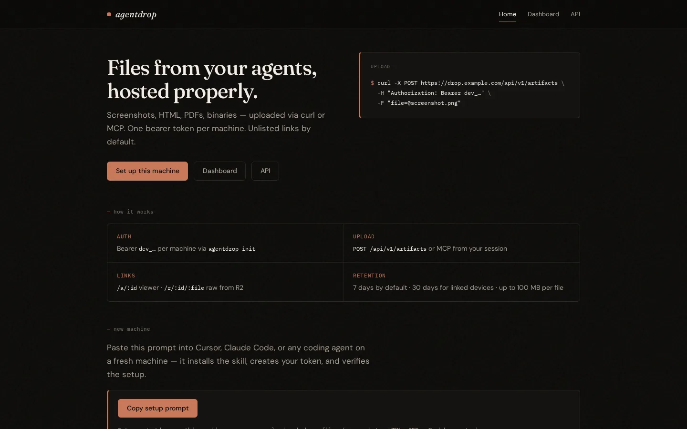
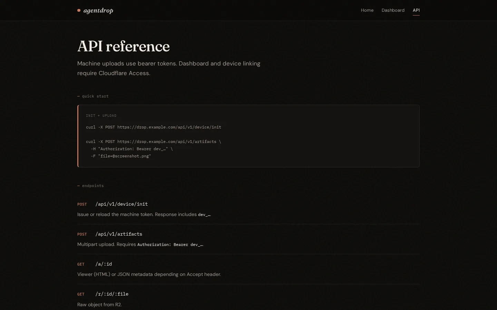
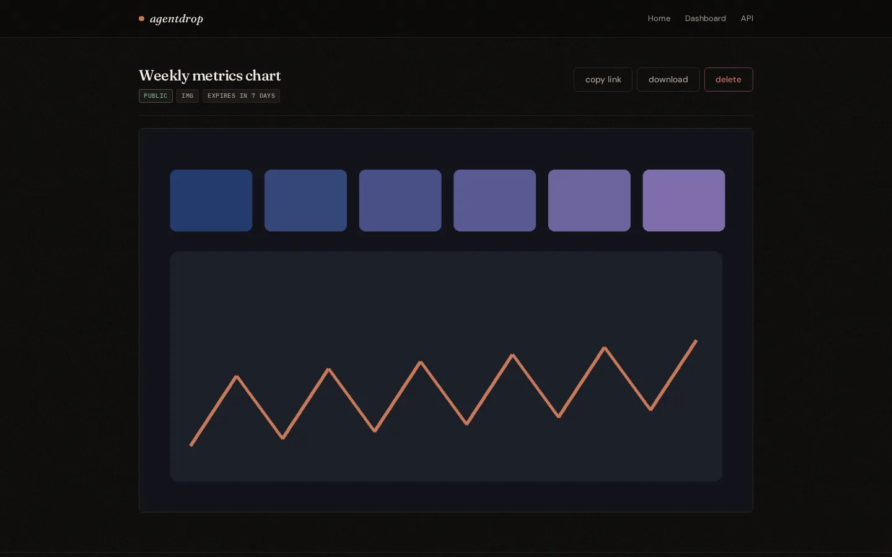

# Agentdrop

Self-hosted file hosting for AI agents. Agents upload screenshots, HTML, video,
PDF, Markdown and other files using one bearer token per machine, and get back
links they can share. It runs entirely on Cloudflare Workers, D1 and R2, and
is MIT licensed.

[](https://deploy.workers.cloudflare.com/?url=https://github.com/L92-Labs/agentdrop/tree/main/apps/api)



- **Upload** from the CLI, with plain `curl`, or over MCP (`POST /mcp`)
- **Share** a file with a public link (an unguessable URL), a secret link (adds a `?s=` token), or a password. Files can also be private.
- **Expire** uploads automatically, or set an expiry per file
- **View** images, video, PDF, HTML (sandboxed) and rendered Markdown in the browser
- **Configure** limits with environment variables: file size, storage, file count, retention and upload rate
- **Optional:** Cloudflare Access for a dashboard and per-user accounts, Turnstile for a verified tier, and an enroll token for private instances
- **Agent skill** at `/skill.md`, so an agent can set itself up

## Deploy

**One click:** press the button above. Cloudflare copies `apps/api` into a new
repository on your GitHub account and creates the D1 database and R2 bucket.
It then asks for:

- the `TOKEN_PEPPER` secret: paste the output of `openssl rand -hex 32`
- the limits, which you can keep at their defaults

Every push to that new repository redeploys the instance.

**From a clone:**

```bash
pnpm install
cd apps/api
npx wrangler login
openssl rand -hex 32 | npx wrangler secret put TOKEN_PEPPER
pnpm run deploy        # creates D1 + R2, applies migrations, deploys
```

Next steps are adding a custom domain, the Access dashboard, Turnstile and CI.
The full guide is **[docs/SELF_HOSTING.md](docs/SELF_HOSTING.md)**.

## Configure

All settings below are optional Worker variables. Set them in
[`apps/api/wrangler.jsonc`](apps/api/wrangler.jsonc), or later in the dashboard
under **Worker → Settings → Variables**. For the variables marked "unlimited",
`0` means no limit.

| Variable | Default | Meaning |
|----------|---------|---------|
| `MAX_FILE_MB` | `100` | Largest single file |
| `MAX_STORAGE_MB` | `2048` | Active storage per owner (a linked account, or an unlinked device). `0` = unlimited |
| `MAX_ARTIFACTS` | `1000` | Active files per owner. `0` = unlimited |
| `MAX_TOTAL_STORAGE_MB` | `0` | Active storage for the whole instance. `0` = unlimited |
| `RETENTION_DAYS` | `7` | Default expiry for uploads from an unlinked device |
| `RETENTION_DAYS_LINKED` | `30` | Default expiry for uploads from a linked device |
| `MAX_RETENTION_DAYS` | `365` | Longest expiry a linked device can choose |
| `UPLOADS_PER_HOUR` | `5` | Uploads per hour for a new device. `0` = the device must be verified or linked before it can upload |
| `UPLOADS_PER_DAY_VERIFIED` | `30` | Uploads per day after the device passes Turnstile |
| `UPLOADS_PER_DAY_LINKED` | `200` | Uploads per day for a device linked to an account |
| `PUBLIC_BASE_URL` | request origin | Public URL used in the links the API returns |
| `CORS_ORIGINS` | `*` | Browser origins allowed to call the API |
| `CF_ACCESS_TEAM_DOMAIN`, `CF_ACCESS_AUD` | empty | Turn on Cloudflare Access (see below) |
| `TURNSTILE_SITE_KEY` | empty | Turn on the Turnstile verified tier. Also needs the secret `TURNSTILE_SECRET_KEY` |

| Secret | |
|--------|--|
| `TOKEN_PEPPER` | **Required.** Hashes device tokens and signs password cookies. Never change it after launch. |
| `ENROLL_TOKEN` | Optional. When set, creating a device requires this token (`agentdrop init <url> --enroll <token>`), so strangers can't upload. |
| `TURNSTILE_SECRET_KEY` | Optional. Used together with `TURNSTILE_SITE_KEY`. |

To change the name, copy, colors and fonts, edit
[`apps/api/src/brand.ts`](apps/api/src/brand.ts). See
**[docs/CUSTOMIZING.md](docs/CUSTOMIZING.md)**.

### Do I need Cloudflare Access?

No. Without Access, any machine can create a device token and upload, within
your rate limits. Use `ENROLL_TOKEN` to make the instance private. Secret
links and password links work for every device.

With Access, people sign in through your identity provider. You also get:

- a dashboard to manage files and devices
- device linking (`agentdrop link`), which gives a device its account's limits and longer retention
- private files

Access is free for up to 50 users. Setup takes about five minutes; see
[docs/SELF_HOSTING.md#cloudflare-access-optional](docs/SELF_HOSTING.md#cloudflare-access-optional).

## Use it

```bash
pnpm cli:link                             # from this repo → ~/.local/bin/agentdrop
agentdrop init https://drop.example.com   # add --enroll <token> on private instances
agentdrop upload ./screenshot.png
agentdrop upload ./report.md              # local images next to it are uploaded too
agentdrop upload ./shot.png --secret      # unlisted ?s= link
agentdrop upload ./shot.png --password "share-secret"
agentdrop status                          # limits, usage, rate limit
agentdrop expires art_… 7d                # or 24h | 30d | now
agentdrop share rotate art_…              # new ?s= token; old links stop working
agentdrop link                            # with Access: link this machine to your account
```

The CLI stores the token in `~/.agentdrop/token.json`. Agents can install the
skill from `https://<your-host>/skill.md`. The full HTTP and MCP reference is
**[docs/API.md](docs/API.md)**; each instance also serves a short version at
`/api`. The MCP endpoint is `POST /mcp`, using the same
device token.

| API docs | Viewer |
|--|--|
|  |  |

## Layout

```
apps/api/           the Worker (deployable on its own, which the Deploy button needs)
  src/brand.ts      name, copy, colors, fonts
  src/limits.ts     env-var limits and their defaults
  migrations/       D1 schema
  wrangler.jsonc    deploy config with every variable listed
packages/cli/       agentdrop CLI (zero-dependency Node script)
docs/               self-hosting, customizing, API, PRD, ADRs
```

## Development

```bash
pnpm install
cp apps/api/.dev.vars.example apps/api/.dev.vars
pnpm dev               # http://localhost:8787
pnpm typecheck && pnpm test:coverage && pnpm test:cli
```

See [CONTRIBUTING.md](CONTRIBUTING.md) and [CHANGELOG.md](CHANGELOG.md). Report vulnerabilities privately as
described in [SECURITY.md](SECURITY.md).

## License

[MIT](LICENSE)
